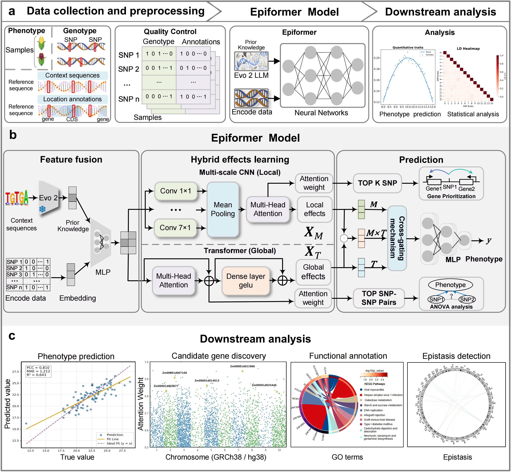

# Epiformer

Epiformer is a PyTorch-based deep learning framework for **epistasis detection** and **phenotype prediction**. It builds a regression model (`Epiformer`) by combining:

- Multi-scale CNN + self-attention (`CNN_self_attention`)
- SNP interaction Transformer (`SNPInteractionAttention`)
- Cross-Gated MLP fusion (`CrossGatedMLP`)

### Framework



---

### Project files

- `Epiformer.py` (**legacy / direct compression**)  
  Original pipeline. It concatenates embedding + genotype + SNP annotation, then applies an early compression projection (`F → 256 → 1`) before training.  
  To better preserve multimodal SNP information, we later refined this into the updated training version below.

- `Epiformer_frozen_training.py` (**updated training script**)  
  A refined training protocol that learns fold-wise supervised fusion before freezing it for backbone training, aiming to better preserve multimodal SNP information than direct early compression.  
  Per fold: supervise-pretrain a fusion MLP → **freeze** it → train the Epiformer backbone → save checkpoints by validation PCC.

- `Base_MLP.py` (**simple baseline**)  
  A dosage-only MLP baseline for phenotype prediction. It reads `genotype_dosage.npy` `(N, P)`, runs 5-fold CV with per-fold standardization, and reports `PCC / MAE`.  
  Default MLP width is `1024-512-256-128` with dropout. Useful as a lightweight reference against Epiformer.

- `singleloci_importance.py`  
  Extracts single-locus (per-SNP) importance scores (from the `CNN_self_attention` branch) and exports averaged feature weights.

- `attention_weight_epi.py`  
  Extracts SNP–SNP interaction attention matrices (from the Transformer branch) and exports an averaged attention matrix.

### Environment setup

We recommend using conda (the project root provides `environment.yml`):

```bash
# In the project root
conda env create -f environment.yml
conda activate Epiformer
```

Minimal dependencies (for reference): Python 3.9+ and

```bash
pip install torch numpy pandas scikit-learn
```

---

### Data preparation

Phenotype-specific inputs live under:

`data/data_zeamap/<phe>/`

The provided example is **HKW**:

`data/data_zeamap/HKW/`

#### Files in `data/data_zeamap/HKW/`

| File | Shape / size | Description |
| --- | --- | --- |
| `genotype_dosage.npy` | `(450, 26081)` float32 | Allele dosage matrix (samples × SNPs) |
| `genotype_encoded.npy` | `(450, 26081, 8)` float32 | One-hot / encoded genotype tensor (samples × SNPs × channels) |
| `SNP_annotation.csv` | `(26081, 13)` | Per-SNP annotation features (numeric) |
| `yData.csv` | `(450, 2)` | Sample index + phenotype value |

Notes:

- **N = 450** samples, **P = 26,081** LD-pruned SNPs.
- `genotype_encoded.npy` is large (~360 MB) and is **not** included in the GitHub repository (GitHub file-size limit). Please download it from the dataset link below and place it under `data/data_zeamap/HKW/` before training. The same applies to `genotype_dosage.npy` if you need the Base_MLP baseline.
- `embeddings.pkl` is **not** shipped in this folder. Training scripts that concatenate contextual embeddings expect you to generate it locally (see FAQ) and place it in the same phenotype directory before running.
- Prefer passing an explicit data path, e.g. `--data_dir data/data_zeamap/HKW`.

> Dataset download link / DOI: https://doi.org/10.6084/m9.figshare.30448166

#### Genotype processing (source of the SNP set)

The genotype inputs were derived from maize SNP data through a standard processing pipeline: quality control (missingness and MAF filtering), followed by LD pruning to obtain a reduced marker set. The resulting pruned SNPs (**26,081** markers) underlie `genotype_encoded.npy`, `genotype_dosage.npy`, and `SNP_annotation.csv`.

---

### Outputs (default)

- Training and interpretation outputs are written to:
  - `result/<phe>/`

---

### Train the model

```bash
# Updated frozen-training protocol on HKW
python Epiformer_frozen_training.py --phe HKW --data_dir data/data_zeamap/HKW

# Legacy direct-compression pipeline
python Epiformer.py --phe HKW --data_dir data/data_zeamap/HKW

# Dosage-only MLP baseline
python Base_MLP.py --phe HKW --data_dir data/data_zeamap/HKW
```

#### Results

- Prints best `PCC / MAE` for each fold
- Prints the final 5-fold average: `PCC ± std` and `MAE ± std`
- Saves per-fold files to `result/<phe>/` (Epiformer) or `result/Base_MLP/<phe>/` (baseline):
  - `all_best_model_fold_<k>.pth`
  - `fold_<k>_best_preds.csv`

---

### Extract single-locus importance

```bash
python singleloci_importance.py
```

#### What it does

- Loads a trained model checkpoint (default: fold 1)
- Extracts single-locus (per-SNP) importance scores from the local `CNN_self_attention` branch
- Averages scores across samples and exports one importance value per SNP to CSV

#### Default inputs/outputs (current script behavior)

**Important**: `singleloci_importance.py` currently hard-codes the following in `main`:

- `args.phe = "KW/"`
- `args.result_dir = "result/KW"`
- `model_path = "result/KW/all_best_model_fold_1.pth"`

Default output file:

- `result/KW/attention_weights_test_3.csv`

---

### Extract SNP interaction attention (epistasis)

```bash
python attention_weight_epi.py
```

#### What it does

- Loads a trained model checkpoint
- Extracts the attention matrix from the `SNPInteractionAttention` branch
- Averages over samples and exports an SNP×SNP attention matrix

#### Default inputs/outputs (current script behavior)

**Important**: `attention_weight_epi.py` currently hard-codes the following in `main`:

- `args.phe = "KW/"`
- `args.result_dir = "result/"`
- `model_path = "result/KW/all_best_model_fold_1.pth"`

Default output file:

- `result/KW/attention_weights_matrix_test.csv`

---

### FAQ / Notes

1. **CUDA / CPU**  
   The code automatically selects `cuda:0` if available; otherwise it falls back to CPU (slower).

2. **Reproducibility**  
   A fixed seed is set (`set_seed(42)`), but small variations may still occur across hardware / library versions.

3. **SNP contextual embeddings (Evo 2)**  
   `data/data_zeamap/HKW/` currently provides genotype and annotation files, but not `embeddings.pkl`. Due to differences across experimental environments, we recommend that users use **Evo 2** to re-embed the contextual sequence around each SNP (typically 10 bp upstream and 10 bp downstream, plus the SNP itself), then save the resulting embeddings as `embeddings.pkl` under `data/data_zeamap/<phe>/` before running embedding-based training or inference.

---

### Contact
- **Email**: `<zhangxiaowei2118@gmail.com>`
